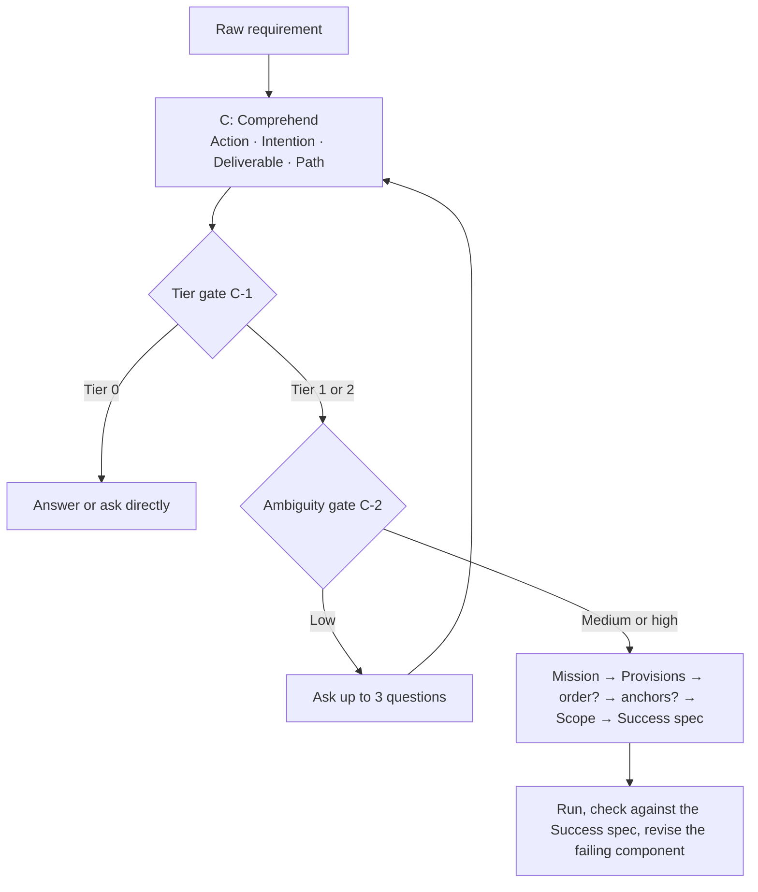

<div align="center">

# 🧭 CoMPaSS Prompt Framework

**Analysis-first prompting for consequential prompts, agent briefs, and decisions.**

Understand what the user is doing and why, before you write a word of the prompt. Then define what done looks like.

[](https://github.com/YourAKShaw/CoMPaSS-prompt-framework/actions/workflows/test.yml)
[](skills/compass-prompt-framework/SKILL.md)
[](skills/compass-prompt-framework/references/limitations.md)
[](LICENSE)
[](.github/CONTRIBUTING.md)

[Explore the skill](skills/compass-prompt-framework/SKILL.md) · [Read the paper](skills/compass-prompt-framework/references/compass-paper.md) · [Documentation](docs/README.md) · [Contribute](.github/CONTRIBUTING.md) · [Get help](.github/SUPPORT.md) · [Security](SECURITY.md)

</div>

---

## Prompts that solve the wrong problem

A well-formed prompt can still fail completely. Asked to "write something to tell my team we're switching to a weekly on-call rotation," a model writes a tidy announcement, and misses that the team is already annoyed about pager load and has to be won over. Asked to "fix" a flaky test, an agent adds a retry, CI turns green, and a race condition ships to production.

Most prompt frameworks (RTF, CO-STAR, RISEN, CRISPE) start at prompt-writing and assume the author already knows the real objective. **CoMPaSS** adds the missing step: a short, mandatory use-case analysis before construction, then a prompt whose optional parts appear only when a stated rule fires, and which always defines how the result is verified.

> Before writing a prompt, work out the **Action** (what is the user doing?), the **Intention** (why?), the **Deliverable or Decision** (what must exist at the end?), and the **Efficient path** (what is the cheapest reliable route?).

**Status: research-grade.** CoMPaSS is an original proposal grounded in published prompting research and vendor guidance. It has **not been benchmarked**, and nothing in this repository claims it beats other frameworks. A [pre-registered evaluation plan](docs/EVALUATION.md) defines how to test it.

## ⚙️ What the skill brings to your agent

| Capability | What it means in practice |
| :--- | :--- |
| **Intention before instruction** | An analysis card captures what the user is doing, why, what must come out, and the cheapest reliable route, with the strongest alternative reading recorded. |
| **Honest gates** | Trivial requests stop at Tier 0 and get a direct answer. At low confidence the agent asks up to three questions instead of guessing; at medium it writes its assumption where you can correct it. |
| **Evidence-driven optionality** | Steps appear only when sequence matters, a non-reasoning model needs decomposition, or an agent needs checkpoints. Examples appear only when a format is easier to show than describe. No default personas. |
| **A mandatory definition of done** | Every prompt ends with an output shape and concrete checks; agent briefs require executable checks and a report of what was not verified. |
| **Model-agnostic method** | It teaches a procedure, not vendor tricks, and treats its section layout as a default rather than a guarantee. |

## 🧩 How it works



| Letter | Component | | Purpose |
| :---: | :--- | :--- | :--- |
| **C** | Comprehend | Mandatory, before writing | Action, Intention, Deliverable/Decision, Efficient path; tier; intention confidence |
| **o** | order of operations | Optional | A required sequence, only when one of three triggers fires |
| **M** | Mission | Mandatory | What to produce or decide, and why |
| **P** | Provisions | Mandatory | The smallest set of high-signal context; pointers for agents |
| **a** | anchors | Optional | Examples or a format template, only when a trigger fires |
| **S** | Scope | Mandatory | Boundaries, non-goals, prohibited shortcuts, assumption policy |
| **S** | Success spec | Mandatory | Output shape plus verification checks |

Uppercase letters are mandatory; lowercase letters are optional. The [component reference](skills/compass-prompt-framework/references/component-reference.md) gives each one a full page.

## 📥 Get started

The skill lives in [`skills/compass-prompt-framework/`](skills/compass-prompt-framework/SKILL.md). Keep that folder intact (`SKILL.md`, `references/`, `assets/`, `scripts/`, `tests/`) so the skill can resolve its resources.

### Claude Code: plugin

```text
/plugin install compass-prompt-framework --marketplace YourAKShaw/CoMPaSS-prompt-framework
```

That one-step form needs Claude Code 2.1.275 or later. On earlier versions, add the marketplace first:

```text
/plugin marketplace add YourAKShaw/CoMPaSS-prompt-framework
/plugin install compass-prompt-framework@compass-prompt-framework
```

### Claude Code: personal or project skill

```sh
git clone https://github.com/YourAKShaw/CoMPaSS-prompt-framework.git
mkdir -p ~/.claude/skills
cp -R CoMPaSS-prompt-framework/skills/compass-prompt-framework ~/.claude/skills/
```

For a project installation, copy it to `.claude/skills/` in that project instead. The entry point must be `~/.claude/skills/compass-prompt-framework/SKILL.md` (or `.claude/skills/compass-prompt-framework/SKILL.md`). Then type `/compass-prompt-framework` in Claude Code, or describe a high-stakes prompt and let Claude select the skill. See the [Claude Code skills documentation](https://code.claude.com/docs/en/skills).

### Claude apps: upload a ZIP

1. Download `compass-prompt-framework-<version>.zip` from the [latest release](https://github.com/YourAKShaw/CoMPaSS-prompt-framework/releases), or build it from a clone:

   ```sh
   cd CoMPaSS-prompt-framework/skills
   zip -r ../compass-prompt-framework.zip compass-prompt-framework -x '*/node_modules/*'
   ```

   The archive must contain one top-level `compass-prompt-framework/` folder with `SKILL.md` directly inside it.
2. Enable **Code execution and file creation** under **Settings → Capabilities**. Organization accounts also need Skills enabled by an administrator.
3. Open **Customize → Skills**, select **+ → Create skill → Upload a skill**, and upload the ZIP. Switch it on.

See Claude's [upload instructions](https://support.claude.com/en/articles/12512180-use-skills-in-claude).

### Skills CLI: other agents

```sh
npx skills add YourAKShaw/CoMPaSS-prompt-framework
```

### Claude API

Upload the skill folder to `/v1/skills` and reference it in `container.skills` with the code execution tool. The [usage guide](docs/SKILL-USAGE.md#claude-api) has the exact requests.

### Check the package

```sh
node ~/.claude/skills/compass-prompt-framework/scripts/validate-skill.ts
```

This offline check needs Node.js 22.18 or later. A pass confirms the package is intact; confirm activation in your host separately. The installation commands follow the linked host and CLI documentation, and the plugin manifests pass `claude plugin validate`; installation has not been exercised on every host.

## 💬 Put it to work

**Brief an agent**

> Use CoMPaSS to brief a subagent: "The checkout-service CI keeps failing on `test_apply_discount` at random. Fix it." Tests run with `pytest`.

**Frame a decision**

> Use CoMPaSS to write the prompt for this decision: should we move our analytics dashboards from Postgres to ClickHouse? Table sizes and slow queries are below.

**Draft a deliverable**

> Use CoMPaSS to write a prompt for an announcement telling my team we're moving to a weekly on-call rotation. People are already annoyed about pager load.

**Review a prompt**

> Review this system prompt against CoMPaSS and list the mandatory gaps first.

These show the analysis the skill performs; they are not claims of evaluated performance. For a trivial question, the skill's first rule is to skip itself.

### Optional helpers

Zero-dependency TypeScript scripts, run directly by Node.js 22.18+:

```sh
node skills/compass-prompt-framework/scripts/analyze-requirement.ts "Should we move to ClickHouse?"
node skills/compass-prompt-framework/scripts/scaffold-prompt.ts "Fix the flaky checkout test."
node skills/compass-prompt-framework/scripts/validate-prompt.ts prompt.md
node skills/compass-prompt-framework/scripts/evaluate-skill.ts plan
```

They draft analysis cards and prompt skeletons from keyword heuristics, check a prompt's structure, and score evaluation runs. Treat their drafts as starting points.

## 📚 Inside the skill

| Material | Contents |
| :--- | :--- |
| [SKILL.md](skills/compass-prompt-framework/SKILL.md) | The method, the 12-step procedure, and four worked examples |
| [Component reference](skills/compass-prompt-framework/references/component-reference.md) | Each component's rules, templates, and common mistakes |
| [Worked examples](skills/compass-prompt-framework/references/worked-examples.md) | Announcement, migration decision, flaky-test agent brief, go-to-market brief, and a Tier 0 counter-example |
| [Positioning](skills/compass-prompt-framework/references/vs-frameworks.md) | ART, RTF, CO-STAR, RISEN, CRISPE, the 3 C's, and context engineering compared |
| [Literature summary](skills/compass-prompt-framework/references/literature-summary.md) | The verified findings behind the rules, with citations |
| [Limitations](skills/compass-prompt-framework/references/limitations.md) and [evaluation plan](skills/compass-prompt-framework/references/evaluation-plan.md) | What CoMPaSS costs and how it should be tested |
| [Templates](skills/compass-prompt-framework/assets/templates/c-analysis-card.md) and [tier decision tree](skills/compass-prompt-framework/assets/tier-decision-tree.md) | Analysis card, section templates, and a full prompt skeleton |
| [CoMPaSS paper](skills/compass-prompt-framework/references/compass-paper.md) | The complete research document, immutable |

## 📂 Inside the repository

```text
CoMPaSS-prompt-framework/
├── skills/compass-prompt-framework/   # The Agent Skill (what gets installed)
│   ├── SKILL.md                       # Entry point
│   ├── references/                    # Paper, generated extracts, component reference
│   ├── assets/                        # Component table, templates, decision tree, examples
│   ├── scripts/                       # Helpers, validators, evaluation harness, generator
│   └── tests/                         # node:test suites and fixtures
├── docs/                              # Usage, architecture, evaluation, maintenance
├── .claude-plugin/                    # Claude Code plugin and marketplace manifests
├── .github/                           # Workflows, issue forms, PR template, contributing, support
├── CHANGELOG.md
├── SECURITY.md                        # Vulnerability reporting policy
└── LICENSE                            # MIT License
```

## Validate the package

From the repository root, with Node.js 22.18+ and Python 3.9+:

```sh
npm ci
npm run check
```

This runs the package validator, the reference drift check, the test suite, and lint. It checks package integrity and consistency with the paper. Prompt quality and agent behavior need the [evaluation plan](docs/EVALUATION.md).

---

## 🤝 Contributing and support

Real failure cases are the most valuable contribution: a request where CoMPaSS misread intent, or where a simpler framework would have done better. So are clearer rules, new examples, and evaluation runs. Start with the [contribution guide](.github/CONTRIBUTING.md), use the [issue forms](https://github.com/YourAKShaw/CoMPaSS-prompt-framework/issues/new/choose), or read the [support guide](.github/SUPPORT.md). Report vulnerabilities privately as described in the [security policy](SECURITY.md), not in a public issue.

## License

Distributed under the **MIT License**. See [LICENSE](LICENSE) for details.
