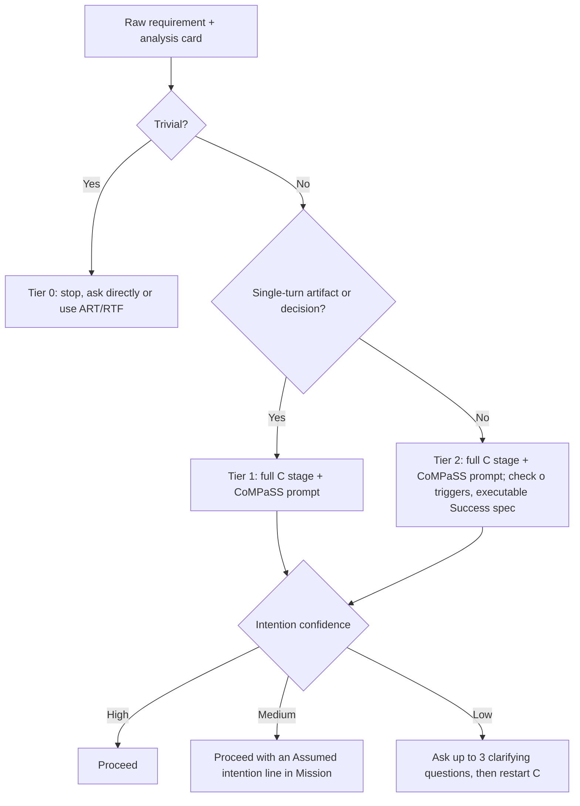

# CoMPaSS Tier Decision Tree

Apply this after filling the four analysis fields (CoMPaSS steps 2–4). The tier gate (rule C-1) decides whether to use CoMPaSS at all; the ambiguity gate (rule C-2) decides whether to ask before writing.

```text
Is this a trivial request? (factual lookup, simple sentence-length answer)
    │
    ├─ YES → Tier 0: Stop (C-1). Ask directly or use ART/RTF.
    │
    └─ NO
        │
        Is this a single-turn artifact or decision? (one prompt, one response)
        │
        ├─ YES → Tier 1: Use CoMPaSS. Run the full C stage, assemble the prompt.
        │
        └─ NO
            │
            Is this multi-step, agentic, or does it require checkpoints?
            │
            └─ YES → Tier 2: Use CoMPaSS. Check the o triggers; an agent that
                     must report between phases fires o-3. Make the Success
                     spec executable checks plus a report of what was and was
                     not verified.

Then, for Tier 1 and Tier 2, the ambiguity gate (C-2):

How confident are you in the user's intention?
    │
    ├─ HIGH   → Proceed. Record the strongest alternative reading and why it was rejected.
    ├─ MEDIUM → Proceed. Write an "Assumed intention:" line into Mission.
    └─ LOW    → Ask at most three clarifying questions, then restart the C stage.
```



## Tier examples

| Requirement | Tier | Why |
|---|---|---|
| "What's the default port for PostgreSQL?" | 0 | One fact; the plain question is the correct choice. |
| "Can you write something to tell my team we're switching to a weekly on-call rotation starting next month?" | 1 | One send-ready message from one prompt. |
| "Should we move to ClickHouse? I've pasted our table sizes…" | 1 (high stakes) | One decision memo from one prompt; the stakes raise care, not the tier. |
| "The checkout-service CI keeps failing on `test_apply_discount` at random. Fix it." | 2 | An agent must reproduce, isolate, fix, and verify across files and runs. |

## Common mistakes

- **Framework creep:** giving a Tier 0 request a full brief because the framework is at hand. The gate only works if it is applied honestly.
- **Tier by length:** a long request can be Tier 1, and a one-line request ("Fix it.") can be Tier 2. Tier follows the work, not the word count.
- **Tier 2 means "add every component":** Tier 2 does not force **o** or **a**. Include each only when its own trigger fires.
